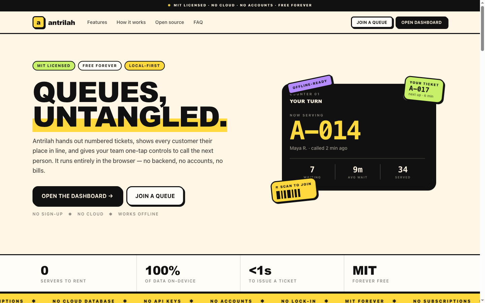
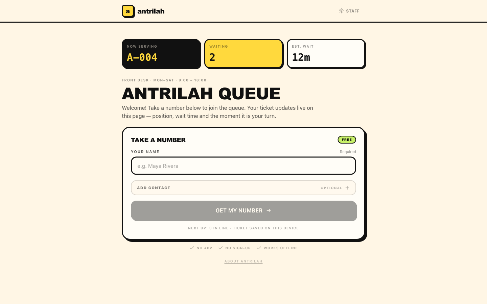
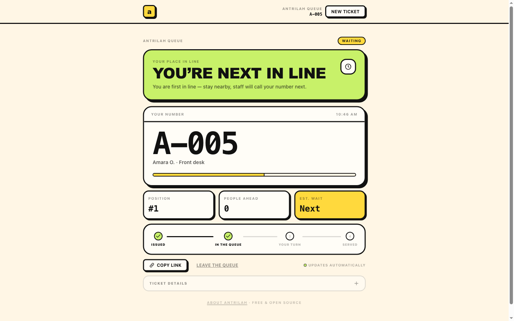
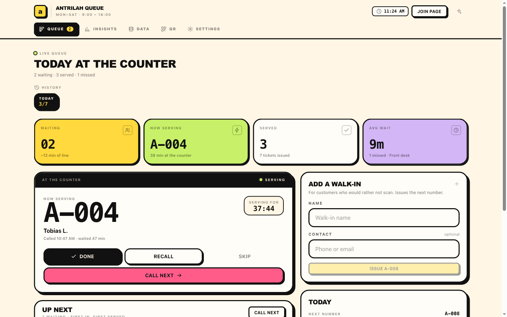
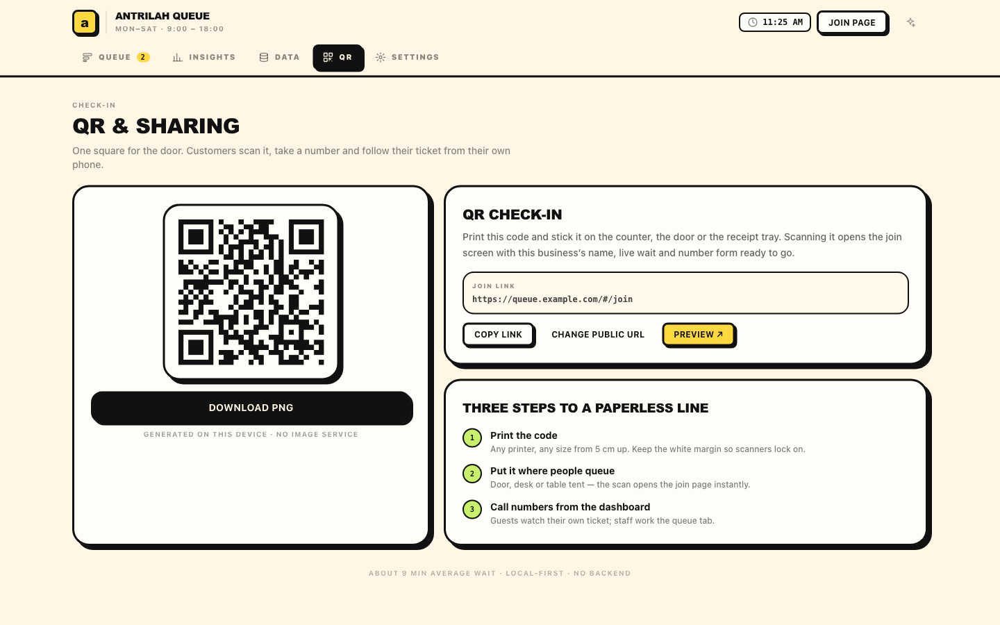
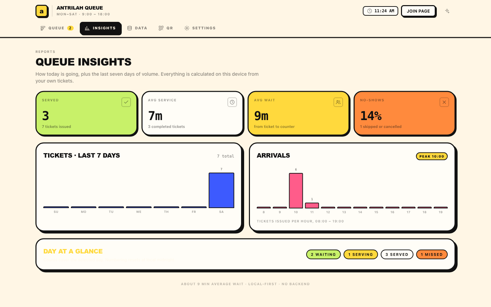
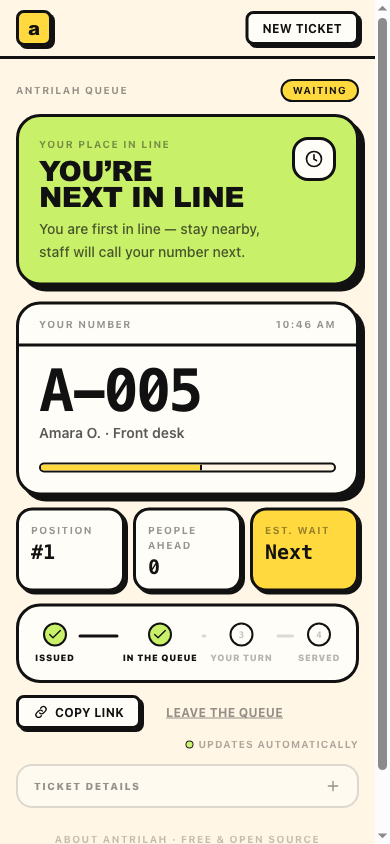
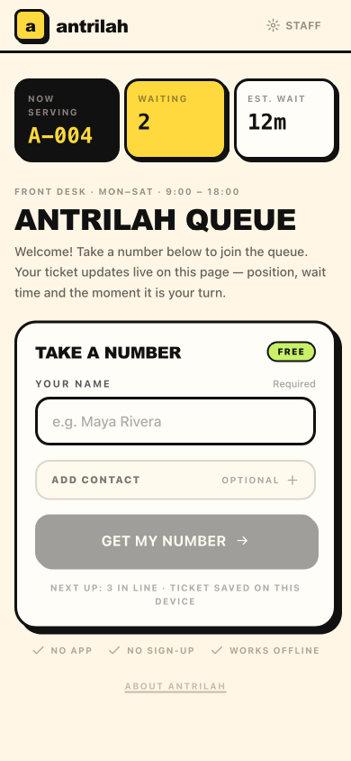

<div align="center">
  

  <h1>Antrilah</h1>

  **A queue that lives in your browser.**

  Numbered tickets, live wait times and a staff dashboard for clinics, salons, repair counters,
  food trucks and pop-ups — with no backend, no accounts, no cloud and no bills.

  [](LICENSE)
  [](#architecture)
  [](#offline--install)
  [](CONTRIBUTING.md)
</div>



Antrilah is a small, complete queue-management app you can host as a folder of static files.
A customer scans the QR code, types a name and gets a number. Their ticket page updates live as
the line moves. Staff call the next person, skip no-shows and close the day from a dashboard
that looks like a printed ticket.

Everything — tickets, settings, history — is stored in the browser's IndexedDB. There is no
server to run, no database to buy and no account to create. After the first load the app keeps
working with the network unplugged.

**MIT licensed. Free forever.**

---

## Contents

- [Why Antrilah](#why-antrilah)
- [Features](#features)
- [Screenshots](#screenshots)
- [Quick start](#quick-start)
- [Using Antrilah](#using-antrilah)
- [Customising](#customising)
- [Architecture](#architecture)
- [Deploying the PWA](#deploying-the-pwa)
- [Development](#development)
- [Verification](#verification)
- [Browser support](#browser-support)
- [Privacy and security](#privacy-and-security)
- [Contributing](#contributing)
- [Changelog](CHANGELOG.md)
- [License](#license)

---

## Why Antrilah

- **Free, actually.** No licence fee, no per-seat pricing, no "pro" tier, no analytics SDK.
- **No backend.** A queue is local state. Antrilah keeps it where it belongs: on the device
  that runs the desk.
- **Works offline.** The whole app shell is precached by a hand-written service worker, so a
  dropped connection never stops the line.
- **One folder to host.** `npm run build` produces a static `dist/` that runs on GitHub Pages,
  a NAS, a USB stick or any web host — no environment variables or database.
- **Small and readable.** About 5,700 lines of TypeScript and CSS, four runtime dependencies,
  and a queue engine you can audit in one sitting.
- **For humans.** Big ticket numbers, one-tap counter controls, keyboard-friendly dialogs and
  layouts that survive a cracked phone screen.

## Features

**For customers**

- QR check-in page with the live now-serving number, waiting count and estimated wait.
- A personal ticket page showing position, people ahead, a progress rail and a clear
  "it's your turn" state that updates itself.
- Shareable ticket link, self-service "leave the queue" with confirmation, no app install.
- Add an optional phone or email for the staff to see at the counter.

**For staff**

- Call next, recall, done, skip and requeue — with a strict status machine so a completed
  ticket can never jump back in line.
- Automatic numbering (`A-001`, `A-002`, …) that cannot double-issue, even with two tabs open.
- Walk-in intake for people who would rather not scan, with a live "next number" preview.
- Day history with read-only previous days, per-day stats and a one-action "clear today".
- Insights: seven-day volume, hourly arrivals, average wait, average service time, no-show rate.
- Optional automations: skip stale waiting tickets, auto-complete long services, keep *N* days
  of history.
- Locally generated QR code with PNG download, copy link and a fixed public URL setting.

**For whoever runs the shop**

- Business settings: name, tagline, service label, number prefix, service minutes, opening
  hours, welcome copy and QR base URL.
- JSON backup to file or clipboard, validated restore (merge or replace), automatic number
  repair, duplicate detection and conflict renumbering.
- Storage-usage readout, retention purge, danger-zone actions behind confirmation dialogs.
- Installable PWA with an update prompt; no telemetry, no third-party requests, no cookies.

## Screenshots

| Customer check-in | Live ticket |
| --- | --- |
|  |  |
| **Staff dashboard** | **QR check-in** |
|  |  |
| **Insights** | **On a phone** |
|  |  |

## Quick start

**Requirements:** Node.js 20 or newer and npm 9+ (any recent version ships with Node 20).
No database, account, API key or internet connection is needed after installing packages.

```bash
git clone https://github.com/Ahdanrikzan/antrilah.git
cd antrilah
npm install
npm run dev
```

Open **http://localhost:3000**.

| Page | What it is |
| --- | --- |
| `/` | Landing page |
| `/#/join` | Customer check-in (this is what the QR code opens) |
| `/#/admin` | Staff dashboard |
| `/#/ticket/:id` | A customer's live ticket |

First run: open `#/admin` and either press **Load demo queue** or add a walk-in to see the
dashboard populated. The dashboard opens a short tour the first time and shows a setup
checklist until the basics are configured.

### Build and preview the production bundle

```bash
npm run build     # type-check, bundle, inject the service-worker precache list
npm run preview   # serve dist/ at http://localhost:3000
```

`dist/` is the entire application. Copy it anywhere that serves static files.

## Using Antrilah

### First run

1. Open `#/admin` → **Settings** and set the business name, service label and number prefix.
2. Open **QR**, download the PNG and stick it on the door or counter. If the app is hosted on a
   fixed domain, set **Change public URL** so printed codes never point at a laptop.
3. Keep the dashboard open on the counter device while the queue is running.
4. Export a backup at the end of the first day (**Data → Export backup**) until you trust the
   routine.

### The customer flow

1. Customer scans the QR code and lands on `#/join`, which shows the current line.
2. They type a name (phone/email optional) and press **Get my number**.
3. Their ticket page opens with the number, position and estimated wait; it refreshes itself
   while open and can be shared or bookmarked.
4. When staff call the number, the page announces "your turn". If plans change, the customer
   can leave the queue instead of being a no-show.



### Running the counter

- **Call next** takes the first waiting ticket and closes whoever was at the counter.
- **Recall** re-announces the current ticket; **Done** closes it; **Skip** marks a no-show.
- Skipped tickets stay in the closed chips and can be returned to the line if the customer
  comes back.
- **Add a walk-in** issues a normal ticket for someone without a phone.
- **Clear today** resets today's tickets and numbering; previous days stay in history.
- Day chips above the stats switch to a previous day. History is read-only, so it can't be
  edited by accident.

### QR check-in

The QR panel renders the code on-device with `qrcode` (no image service), downloads a PNG,
and copies the join link. By default the code points at the current address; set a fixed
public URL once the app is hosted so old printouts keep working.

### Backup and restore

**Data → Export backup** writes `antrilah-backup-YYYY-MM-DD.json` with every ticket and all
settings. Restore accepts a file or pasted JSON and validates it before writing anything:

- **Merge** keeps local tickets and adds what's missing.
- **Replace all** clears local tickets first.
- Conflicting day + number pairs are renumbered, and duplicate IDs are skipped — restoring the
  same file twice is safe.

The schema and every validation rule are documented in
[docs/backup-format.md](docs/backup-format.md).

### Offline and install

The production build precaches the shell, so reloading with no network still opens the app and
the queue keeps working. Old days are removed only when you run **Data → History cleanup**;
nothing expires on its own. In Chrome/Edge the address bar offers **Install**; on iOS use
*Share → Add to Home Screen*.

Offline caching is production-only on purpose: in `npm run dev` the service worker is not
registered, which keeps hot reload instant. To test offline behaviour, run
`npm run build && npm run preview`, load the page once, then disable the network.

### Resetting

- **Clear today's queue** — resets today's numbering, keeps history.
- **Delete all tickets** — wipes every ticket and counter, keeps settings.
- Clearing site data in the browser removes everything, including settings. Export first if the
  data matters.

## Customising

| What | Where |
| --- | --- |
| Business name, prefix, service minutes, hours, welcome copy, QR URL | **Admin → Settings** |
| Automations and retention | **Admin → Settings → Automations** |
| Default settings for a fresh install | `DEFAULT_SETTINGS` in [`src/lib/db.ts`](src/lib/db.ts) |
| Colours, fonts, border thickness | [`tailwind.config.js`](tailwind.config.js) and `src/index.css` |
| Copy and sections on the landing page | [`src/pages/Landing.tsx`](src/pages/Landing.tsx) |
| Queue rules and numbering | [`src/lib/queue.ts`](src/lib/queue.ts) |
| App name, icons, theme colour | `public/manifest.webmanifest`, `index.html`, `public/icon.svg` |

The design system is colour-semantic: yellow waits, lime serves, blue completes, orange misses,
pink is destructive, violet is informational. Change the palette in `tailwind.config.js` and
every component follows. No CSS framework or component library is bundled beyond Tailwind
utilities.

## Architecture

```
React pages ──► lib/queue.ts (queue service) ──► lib/db.ts (Dexie) ──► IndexedDB
     │                    │
     │                    └──► lib/sync.ts (BroadcastChannel change signal)
     └──► lib/hooks.ts (useQuery: read + refresh on write, focus, poll)
```

- **Pages** are presentational: they read through `useQuery` and call queue functions.
- **`lib/queue.ts`** owns every mutation and the status machine; illegal moves throw a typed
  `QueueError`.
- **`lib/db.ts`** defines the Dexie schema (`tickets`, `settings`, `counters`) and settings.
- **`lib/backup.ts`** builds, validates and imports backups; **`lib/pwa.ts`** registers the
  service worker in production only.

Vite serves and bundles; the only build-time customisation is a small plugin that injects the
hashed asset list into `public/sw.js`, so there is no Workbox or extra runtime.

### Numbering in one paragraph

`issueTicket` runs a read-write transaction over `tickets` **and** a per-day `counters` row,
takes `max(lastSeq, highest seq) + 1`, and writes the ticket and the new cursor together.
IndexedDB serialises overlapping read-write transactions, including across tabs, so two taps on
"Get my number" can never produce the same code. Numbering resets at local midnight because the
cursor is keyed by the local calendar day.

### Data model and status rules

`tickets` stores `dayKey`, `seq`, `code`, `name`, contact fields, `status`, timestamps and a
compound `[dayKey+status]` index; `counters` stores `lastSeq` and `issued` per day; `settings`
is a single row. The full schema, the allowed status transitions and the import rules live in
[docs/development.md](docs/development.md).

## Deploying the PWA

`npm run build` writes a self-contained `dist/`. There is nothing to configure and no
environment variables to set.

| Host | How |
| --- | --- |
| **GitHub Pages** | Enable Pages → *GitHub Actions*; the included workflow (`.github/workflows/pages.yml`) builds and deploys on every push to `main` |
| **Cloudflare Pages / Netlify / Vercel** | Build command `npm run build`, output directory `dist` |
| **nginx / Apache / any static host** | Copy `dist/` to the web root |
| **Local network** | `npm run preview -- --host 0.0.0.0`, then open the LAN address on the counter device |

- **Subdirectories work.** Assets and the service worker use relative paths, so
  `https://example.com/queue/` is fine.
- **HTTPS is required for the service worker** (and therefore offline mode and installation).
  `localhost` is exempt, which is why `npm run preview` works without TLS.
- **Updating:** deploy the new `dist/`. Returning visitors get the cached app instantly and an
  in-app "New version ready → Reload" prompt once the new worker installs; the old cache is
  deleted on activation. Bump `VERSION` in `public/sw.js` if you change caching behaviour.
- **Cache headers:** do not cache `sw.js` for long. A `Cache-Control: no-cache` header on
  `/sw.js` is ideal; hashed assets under `/assets/` can be cached forever.

Step-by-step instructions for Pages, Cloudflare Pages, Netlify and nginx (including the
subdirectory case) are in [docs/deployment.md](docs/deployment.md).

## Development

```bash
npm install          # install dependencies
npm run dev          # Vite dev server with HMR on :3000
npm run typecheck    # tsc --noEmit
npm run build        # type-check + production build
npm run preview      # serve the production build
```

- **Where to add things:** a new customer screen goes in `src/pages/`, a shared visual in
  `src/components/ui.tsx`, a queue rule in `src/lib/queue.ts` with a guard in
  `ALLOWED_TRANSITIONS` if it changes state.
- **Style:** TypeScript everywhere, no `any` at module boundaries, functions that change data
  live in `lib/` rather than inside components, and every destructive action goes through
  `<Dialog>`.
- **Dependencies:** four runtime packages, all local. Please open an issue before adding one.
- **Tests:** the project currently relies on a manual checklist (below) rather than a test
  runner. Adding Vitest coverage for `lib/queue.ts` and `lib/backup.ts` is a welcome first
  contribution.

The manual test checklist and deeper notes are in [docs/development.md](docs/development.md).
Repository settings, topics and the release checklist are in [docs/release.md](docs/release.md).
An index of every document lives in [docs/README.md](docs/README.md).

## Verification

Checked in Chromium on 2026-11-14 against both the dev server and the production build:

- **Numbering** — 30 tickets issued simultaneously from two tabs produced sequences 1–30 with
  unique codes; clearing the day restarts at 001; restores continue from the last number.
- **Status rules** — illegal moves rejected (`waiting → done`, `done → waiting`,
  `cancelled → serving`), `skipped → waiting` works, and calling a second ticket closes the
  first so only one ticket is ever at the counter.
- **Customer flow** — form validation, ticket page, returning-ticket banner, leave-queue dialog
  (cancel keeps the place, confirm cancels), copy-link, all dialogs and disclosures.
- **Backup** — export downloads the documented JSON; file and paste restore; duplicate merge
  skips existing tickets; conflicting numbers are renumbered; replace-all wipes then restores;
  malformed JSON is rejected with a specific message and no writes.
- **Operations** — walk-in intake, serve/done/skip/recall/requeue, day history (read-only),
  retention purge, QR render + PNG download, settings save/reset, delete-all.
- **Offline** — the service worker precached the shell; reload, hash navigation, taking a
  number and the lazy-loaded dashboard all worked with the network disabled.
- **Layouts** — no horizontal overflow at 1440, 390 or 320 px on any page.

Known limits: the screenshots above are from Chromium; scanning a printed QR with a phone,
Safari/Firefox specifics and screen-reader output are not covered by that test pass yet.

## Browser support

Latest Chrome, Edge, Firefox and Safari (desktop and mobile). The app needs IndexedDB,
`BroadcastChannel`, service workers (for offline) and ES2020 — all available in browsers from
around 2021 onwards. If storage is blocked (some private modes), Antrilah explains the problem
instead of showing a broken queue.

## Privacy and security

- No analytics, cookies, trackers, remote fonts or third-party scripts.
- The only network requests are for the app's own files and (optionally) the backup file you
  choose — nothing is uploaded.
- Queue data stays in the browser profile that created it. Different browser, different device
  or cleared site data means a fresh queue, so export backups.
- Nothing secret is stored in the repository: there are no API keys, accounts or paid services
  to configure. See [SECURITY.md](SECURITY.md) for reporting a vulnerability.

## Contributing

Contributions are welcome — bug reports, docs, translations and code. Please read
[CONTRIBUTING.md](CONTRIBUTING.md) first; it covers setup, style, the "no backend, no paid
services" rule and how to run the checks. By taking part you agree to the
[Code of Conduct](CODE_OF_CONDUCT.md).

Good first issues: Vitest coverage for the queue engine, keyboard shortcuts on the dashboard,
print stylesheet for the QR poster, and Firefox/Safari testing.

- [Report a bug](https://github.com/Ahdanrikzan/antrilah/issues/new?template=bug_report.yml)
- [Request a feature](https://github.com/Ahdanrikzan/antrilah/issues/new?template=feature_request.yml)
- [Open a pull request](https://github.com/Ahdanrikzan/antrilah/compare)

## License

[MIT](LICENSE) © 2026 Antrilah contributors.

Free to use, copy, modify, merge, publish, distribute, sublicense and sell. No account, API key
or invoice required, and no attribution on the customer-facing screen.
